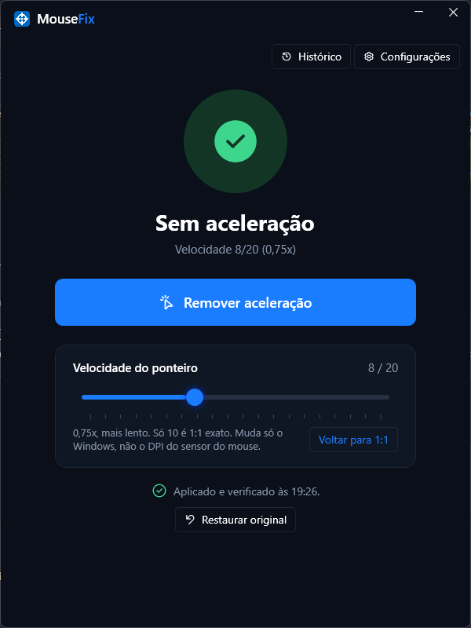

# MouseFix

Remove a aceleração do mouse no Windows com um clique, mantém ela desligada e mostra, com testes, se o seu mouse está realmente 1:1. Também verifica a mira do **Free Fire** no **MSI App Player / BlueStacks 5**.

Grátis e de código aberto. Não precisa de administrador nem de instalar nada.



## Download

Na página de **[Releases](../../releases/latest)**, baixe um dos dois:

- **`MouseFix-Setup-x.y.z.exe` (recomendado):** instalador. Cria o atalho na **área de trabalho** e no Menu Iniciar, e aparece em "Adicionar ou remover programas" para desinstalar. Não pede administrador.
- **`MouseFix.exe`:** versão portátil, sem instalar. É só abrir.

Funciona no Windows 10 e 11 (64 bits).

> **O Windows pode mostrar "O Windows protegeu o computador".** Isso acontece porque o app é novo e não tem assinatura digital (que é paga). Clique em **Mais informações → Executar assim mesmo**. Se preferir, confira o código SHA-256 do arquivo (está na página do release) ou compile você mesmo a partir deste código.

## O que ele faz

**Tela única, sem complicação**
- Um botão grande: **Remover aceleração**. Desliga "Aumentar precisão do ponteiro" (a aceleração do Windows) na hora.
- **Velocidade do ponteiro (1 a 20)** sem aceleração. Só 10/20 é 1:1 exato (1 ponto do sensor = 1 pixel). Muda só o Windows, não o DPI do mouse.
- **Aplica e verifica:** depois de cada mudança, o MouseFix lê o Windows de volta e mostra "Aplicado e verificado" ou exatamente o que não pegou.
- **Histórico:** o que mudou, quando, quem mudou (você, um perfil ou outro programa, com o nome) e se foi verificado.
- **Guarda suas configurações originais** e volta tudo com **Restaurar original**.
- Em Configurações: velocidade de rolagem, interruptor de aceleração (se você quiser mesmo ligá-la), perfis, emulador, testes e ajuda.
- Grava curvas lineares de proteção (o "MarkC fix"): se algum programa ligar a aceleração, o movimento continua igual. Valem depois de sair da conta do Windows e entrar de novo uma vez.

**Em segundo plano (na bandeja)**
- **Proteção automática:** se algum programa mudar a aceleração ou a velocidade, o MouseFix desfaz em até 0,1 segundo e anota no histórico quem foi.
- **Perfis por programa:** escolha uma velocidade para um programa (ex.: o emulador). Quando ele abre, o MouseFix troca a velocidade sozinho; quando fecha, volta ao padrão. A aceleração fica sempre desligada.
- Opção de **iniciar com o Windows**.
- **Aviso de versão nova** (pode desligar): consulta o GitHub uma vez por dia.
- **Reportar problema:** abre o GitHub com um relatório já preenchido (versão, Windows e log), que você revisa antes de enviar.
- Avisa se um software de mouse (Razer Synapse, Logitech G HUB, Corsair iCUE...) está aberto, porque eles podem aplicar aceleração no driver.

**Testes (em Configurações)**
- **Precisão do Windows:** lê o sensor direto (Raw Input) e compara com o cursor em várias velocidades. Mostra "1:1 confirmado" ou "aceleração detectada".
- **Distância:** você arrasta o mouse a mesma distância devagar e rápido. Mostra se o mouse ou o driver dele aplica aceleração, o **DPI real** e o **polling rate**.

**Emulador (MSI App Player / BlueStacks 5 com Free Fire ou Free Fire MAX)**
- Mostra se a aceleração do emulador está ligada e desliga, se precisar (com backup).
- **Teste do emulador:** descobre se a mira do jogo segue o cursor do Windows ou lê o sensor direto.
- Se a velocidade do Windows mudou, sugere e aplica a sensibilidade certa para a mira continuar com a mesma sensação.

## O que ele NÃO faz (seja realista)

- **Não é hack nem aim assist.** Não mexe no jogo, não injeta nada, não lê memória. Só altera configurações do Windows e o arquivo de controles do emulador, que você mesmo poderia alterar.
- **Jogos de PC que usam Raw Input** (Valorant, CS2 e a maioria dos FPS atuais) já ignoram a aceleração do Windows. Neles o MouseFix não muda nada.
- **Não remove o comportamento próprio do jogo.** O Free Fire foi feito para toque e tem assistência de mira; o emulador converte o mouse em "dedo arrastando". Isso nenhum app de PC muda.
- Aceleração aplicada **dentro do mouse ou do driver** não é removida pelo MouseFix. O teste de distância mostra se ela existe; aí desligue no software do fabricante.

## Perguntas frequentes

**Mudar a velocidade do ponteiro cria aceleração?**
Não. A velocidade multiplica todo movimento pelo mesmo valor. Aceleração é quando o multiplicador muda conforme a rapidez da mão. Mas só 10/20 é 1:1 exato: abaixo disso o cursor precisa de mais de um ponto para andar 1 pixel, acima disso ele pula pixels. Para mudar a velocidade, use o controle **Velocidade do ponteiro** no MouseFix (se mudar nas Configurações do Windows com a proteção ligada, o MouseFix volta para a velocidade escolhida nele).

**Minha mira no emulador ficou mais rápida depois do MouseFix.**
Sua velocidade do Windows provavelmente era menor que 10. Faça o **Teste do emulador**. Se ele confirmar que a mira segue o cursor do Windows, clique em **Aplicar sensibilidade**: a mira volta à sensação de antes e fica mais precisa.

**Como desfaço tudo?**
Clique em **Restaurar** (volta suas configurações originais) e depois em **Sair** no ícone da bandeja. Se instalou com o instalador, desinstale em **Configurações → Aplicativos**. Para o emulador, o arquivo original fica salvo ao lado do original com a extensão `.mousefix.bak`.

**O MouseFix coleta algum dado?**
Não. O único acesso à internet é a verificação de versão nova: uma vez por dia ele pergunta ao GitHub qual é a última versão (`api.github.com`), sem enviar nenhum dado seu. Você pode desligar em **"Avisar quando sair versão nova"**. O botão **Reportar problema** só abre a página do GitHub no navegador; nada é enviado até você mesmo clicar em enviar lá, e o nome da sua pasta de usuário é trocado por `%USERPROFILE%`. Todo o resto fica no seu PC, em `%AppData%\MouseFix` (backup, configurações e log).

## Compilar a partir do código

Requer o [.NET 8 SDK](https://dotnet.microsoft.com/download/dotnet/8.0).

```
dotnet test
dotnet run --project src/MouseFix.App
```

Gerar o `.exe` único (não precisa de .NET no PC de quem usar):

```
dotnet publish src/MouseFix.App -c Release -r win-x64 --self-contained true -p:PublishSingleFile=true -p:IncludeNativeLibrariesForSelfExtract=true -p:EnableCompressionInSingleFile=true -p:DebugType=none -o publish
```

Gerar o instalador (requer o [Inno Setup 6](https://jrsoftware.org/isinfo.php); rode depois do comando acima):

```
ISCC.exe installer\MouseFix.iss
```

O instalador sai em `installer\Output\`.

Estrutura:
- `src/MouseFix.Core`: lógica (configurações do Windows, backup, curvas, analisadores dos testes, arquivos do emulador).
- `src/MouseFix.App`: interface WPF, bandeja, monitor de proteção e janelas de teste.
- `tests/MouseFix.Core.Tests`: testes automáticos.

## Licença

[MIT](LICENSE). Pode usar, modificar e distribuir, mantendo o aviso de copyright.

MouseFix não tem relação com Garena, MSI, BlueStacks, Razer, Logitech ou outras marcas citadas; os nomes aparecem só para indicar compatibilidade.
